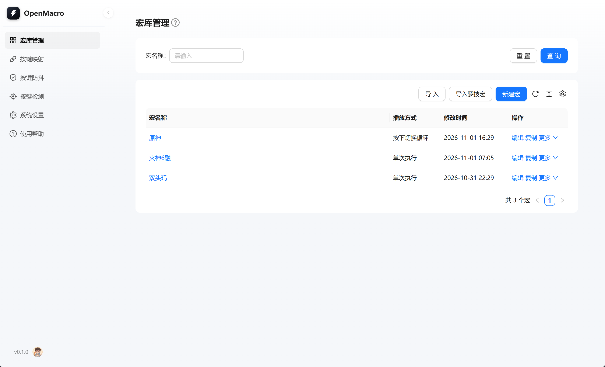
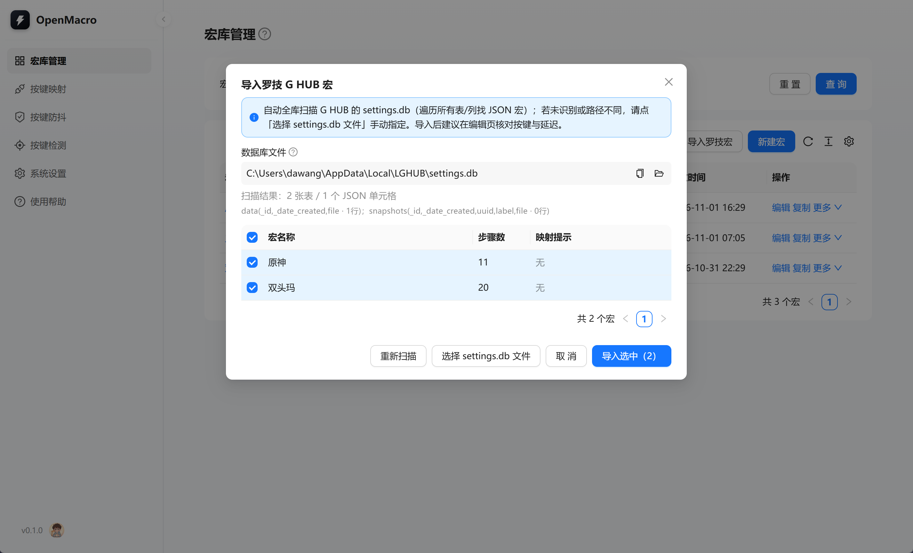
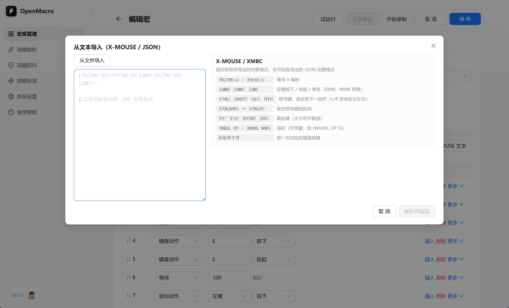
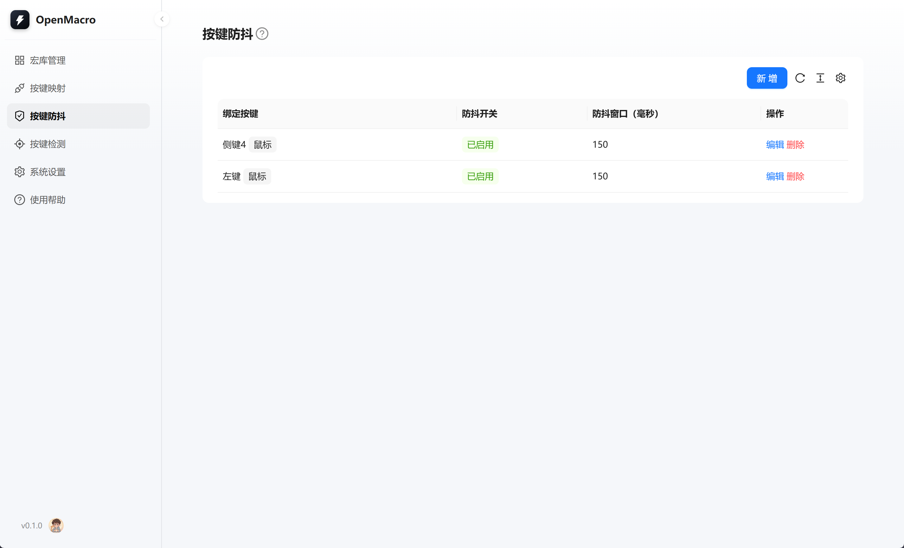
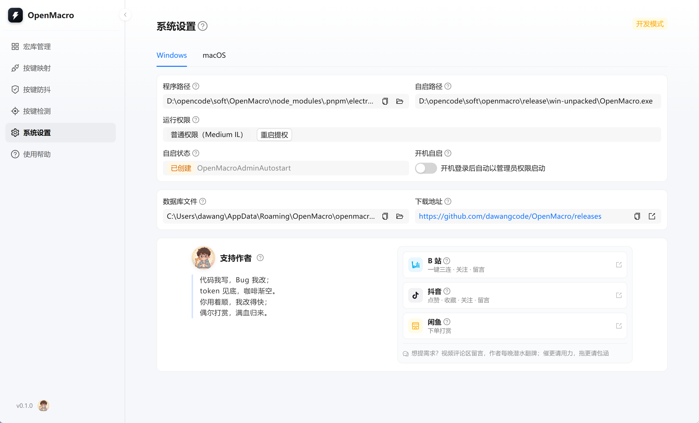

# OpenMacro


宏支持导入导出

支持导入罗技 G HUB 宏

支持导入X-MOUSE宏

支持按键防抖，侧键双击用户福音。延长用户鼠标寿命。

支持以管理启动，解决罗技 G HUB每次都要用管理员打开才能在原神里面使用的问题。


## 目录结构

```
OpenMacro
├── .umirc.ts                 # 客户端形态 Umi 配置（hash + base/publicPath '/'）+ 路由
├── electron.vite.config.ts   # 仅构建 main/preload
├── electron-builder.yml      # 打包配置（files 含 dist/ + out/，asarUnpack *.node）
├── tsconfig.json / tsconfig.node.json
├── scripts/                  # 一键启动三件套（start.cmd / start-client.js / launch-client.js）
└── src/
    ├── main/                 # 主进程
    │   ├── index.ts          # 窗口 / 单实例 / 内置静态服务
    │   ├── ipc.ts            # IPC handler（macro:* / record:* / binding:* / capture:* / detect:*）
    │   ├── db.ts             # node:sqlite 连接 / 建表 / settings 读写 / 事务
    │   ├── migrate.ts        # 旧 config.json → SQLite 一次性迁移（user_version 标记）
    │   ├── store.ts          # 设置（config）持久化，走 settings 表
    │   ├── macro-store.ts    # 宏持久化与导入导出解析
    │   ├── recorder.ts       # 录制状态机（倒计时 → 采集 → 步骤）
    │   ├── player.ts         # 回放执行（循环展开 / 循环模式 / 速度 / 停止）
    │   ├── input-backend.ts  # uiohook-napi + nut-js 懒加载与降级
    │   ├── hook.ts           # 全局输入钩子中枢（录制 / 绑定 / 检测共用一份 uiohook）
    │   ├── actions.ts        # 原子输入动作（键盘 / 鼠标 / 系统命令 / 启动程序）
    │   ├── binding-store.ts  # 按键绑定 / 防抖 / 停止热键持久化
    │   ├── binding-engine.ts # 绑定运行时（防抖 → 触发判定 → 执行动作）
    │   ├── detector.ts       # 按键检测（最新 100 条事件 + 重复计数）
    │   ├── capture.ts        # 按键捕获（绑定键 / 停止热键字段用）
    │   ├── runtime-state.ts  # 跨模块「绑定运行时挂起」开关
    │   ├── keymap.ts         # 键名映射
    │   └── events.ts         # 主进程 → 渲染进程事件白名单
    ├── preload/              # 预加载 index.ts（CJS 产物）
    ├── layouts/index.tsx     # 全局布局（antd 原生 Layout + Menu）
    ├── pages/binding/index.tsx    # 按键映射列表（PRD 4.1）
    ├── pages/binding/edit.tsx     # 绑定编辑（独立页 /binding/edit/:key?trigger=）
    ├── pages/debounce/index.tsx   # 按键防抖（独立页 /debounce，PRD 4.3）
    ├── pages/detect/index.tsx     # 按键检测看板（PRD 4.2）
    ├── pages/macro/index.tsx      # 宏库管理（列表页，PRD 4.4）
    ├── pages/macro/create|edit    # 宏录制与编辑（新建 / 编辑各自独立路由，PRD 4.5）
    ├── pages/macro/detail.tsx     # 宏详情（独立只读详情页）
    ├── api/macro.ts               # 数据层（Electron 优先，浏览器模式降级 localStorage）
    ├── api/binding.ts             # 绑定 / 防抖 / 检测数据层
    ├── utils/display.ts           # 键名 / 时间展示助手
    ├── utils/macro.ts             # 步骤摘要（编辑页 / 详情页共用）
    ├── types/macro.ts             # 宏领域模型与常量（renderer / main 共用）
    ├── types/binding.ts           # 绑定领域模型与常量
    ├── global.less
    └── typings.d.ts          # electronAPI 类型声明
```


## 常用命令

```bash
# 安装依赖（pnpm，peer 冲突默认忽略；uiohook-napi 为本地 fork 源码，allowBuilds 已放行）
# postinstall 会自动编译本地 fork 源码（node-gyp，首次约 1-2 分钟）；
# 改 D:\opencode\soft\uiohook-napi-patch 源码后跑 pnpm install 即自动同步 + 重编；
# 若编译失败（缺工具链），手动跑：pnpm run rebuild:uiohook
pnpm install

# 开发模式 A：纯浏览器（快速改 UI/样式，无 Electron 壳，录制/回放自动降级为不可用）
pnpm run dev        # Umi dev server :8000，浏览器打开

# 开发模式 B：套壳开发（Electron 窗口 + HMR + DevTools，调录制/回放/IPC 用这个）
pnpm run dev:app    # max dev + 等 8000 就绪后拉起 Electron 窗口加载 localhost:8000

# 一键启动（生产形态，内置 HTTP 托管 dist/，不开浏览器）
#   Windows 双击 start.cmd；或 pnpm run start
pnpm run start

# 构建 renderer(dist/) + 壳(out/)
pnpm run build

# 图标已内置（resources/icon.png / .ico / .icns，由 scripts/gen-icon.js 生成，换色改脚本常量后重跑）
# 打包安装包
pnpm run package
```

